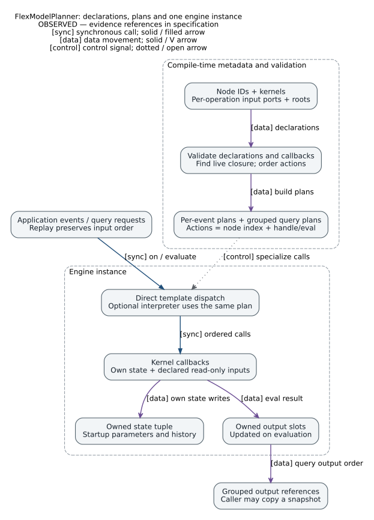
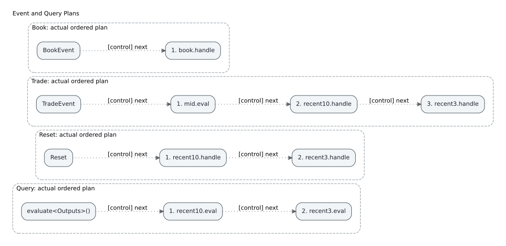

# FlexModelPlanner

FlexModelPlanner is a C++20 library for computing features from streams of events such as order-book updates, trades, and timers. It compiles node dependencies into a separate execution plan for each event type. Two trades at the same price still run the handler twice; queries compute values without advancing event history.

This is an independent implementation inspired by Jane Street's [Flex Model blog post](https://blog.janestreet.com/flex-model-an-event-driven-feature-engineering-system/). It provides static graph planning, state ownership, execution, and replay primitives. Applications supply market-data ingestion, timestamp ordering, and persistence.

## Quick start

You need CMake 3.20 or later and a C++20 compiler. The library is header-only and has no third-party C++ dependencies. From the repository root, run:

```sh
cmake -S . -B build-gcc -DCMAKE_BUILD_TYPE=Release -DCMAKE_CXX_COMPILER=g++
cmake --build build-gcc --parallel
ctest --test-dir build-gcc --output-on-failure
./build-gcc/recent_trade_vs_mid
./build-gcc/csv_replay examples/sample.csv
```

The first example prints the book, trade, reset, and query plans, followed by:

```text
recent10=1.66667, recent3=1.66667
```

The three recorded `trade_price - mid` differences are `2, 2, 1`. Both features use the same kernel, with independent windows of 10 and 3 trades. During warm-up, each average uses the number of trades received so far. The CSV example produces:

```text
Q,1.66667,1.66667
Q,0,0
Q,2,2
```

On Windows, configure with `cmake -S . -B build`, then run `cmake --build build --config Release` and `ctest --test-dir build -C Release`. Executables are placed in `build/Release/`.

## Defining a feature

An `Id` identifies a node in the graph. A `Kernel` defines its state and computation. A `node` declares which events it handles and which inputs it reads. You can reuse one kernel under several IDs; each node keeps its own state.

This complete program counts ticks and queries the current count:

```cpp
#include <flexmodel/flexmodel.hpp>
#include <iostream>
#include <tuple>

struct Tick {};
struct CountId {};
struct Count {
    struct state_type { int count = 0; };
    using value_type = int;
    static void handle(state_type& state, const Tick&) noexcept {
        ++state.count;
    }
    static int eval(const state_type& state) noexcept {
        return state.count;
    }
};

using Graph = flexmodel::graph<
    flexmodel::node<CountId, Count,
        flexmodel::on<Tick>, flexmodel::eval<>>>;

int main() {
    flexmodel::engine<Graph> engine;
    engine.on(Tick{});
    engine.on(Tick{});
    auto result = engine.evaluate<flexmodel::query<CountId>>();
    std::cout << std::get<0>(result) << '\n';  // 2
}
```

The template arguments describe the graph at compile time. At runtime, you call `engine.on(event)` as usual, and initialization parameters remain ordinary data. For example, [market_kernels.hpp](examples/market_kernels.hpp) receives its window lengths through `make_engine(10, 3)`.

Declare dependencies as input ports on the operation that reads them:

```cpp
flexmodel::on<TradeEvent,
    flexmodel::inputs<flexmodel::value_of<MidId>>>
```

This gives the trade handler a freshly computed mid value. Its corresponding signature is `handle(State&, const TradeEvent&, const double&) noexcept`. To read book state instead, declare `state_of<BookId>` and accept `const BookState&`. Callbacks do not receive the entire engine, so the node data available through this interface is limited to their declared inputs.

A node can declare both `on<TradeEvent, ...>` and `on<Reset>`. With no mid input on the reset operation, the reset plan does not compute mid. To select a callback explicitly, use `on<Event, Inputs, &function>` or `eval<Inputs, &function>`.

## Plans, state, and queries



By default, `engine<Graph>` schedules all nodes. `engine<Graph, roots<FeatureId>>` schedules only the selected roots and the transitive closure of their operation dependencies. Handlers in that live closure run on every matching event, even when no query follows. Root selection reduces scheduled work; the state tuple still contains every node in the graph. Query outputs must belong to the live closure and have an evaluator.

The planner treats a node's handler and evaluator as separate actions. Before a state read, it runs the producer's handler for the current event, if one exists. A value read also requires the producer's evaluator. Each shared action runs once per plan. Consecutive queries each perform their own evaluation; there is no memoization across queries or cutoff across events.

`evaluate<query<A, B>>()` computes both outputs together and evaluates shared dependencies once. Its `tuple<const Value&...>` borrows references to the engine's output slots, which later evaluations may update. To retain a snapshot, use `evaluate_into<Query>(output_tuple)` to copy values into caller-owned storage. `state<Id>()` exposes a read-only state view; `cached_value<Id>()` explicitly permits a stale value.



`event_plan<Event>()` and `query_plan<Query>()` expose inspectable plans; `dump_plan` prints them for diagnostics. The default executor expands actions into direct template calls. `on_interpreted` and `evaluate_interpreted` dispatch the same plan one action at a time for comparison. Because both executors share the planner, the tests also use independent arithmetic oracles.

Kernel state may allocate at startup. The example's ring buffers do not grow after initialization, and its callbacks and scalar outputs do not allocate. A dedicated test tracks the C++ `new` family: its zero-allocation result covers framework dispatch and the tested example paths. Arbitrary `malloc` calls, custom allocators, and allocations in user kernels remain the application's responsibility to check.

An output `value_type` must be default-constructible and support non-throwing assignment from the returned value. Neither `noexcept` nor read-only parameters guarantee freedom from global side effects. Each engine is single-threaded and non-reentrant; separate instances may be owned by separate threads.

## Replay and integration

`replay(engine, range)` processes a range of typed or `std::variant` events in input order. An optional observer receives `(engine, event, index)` after each event. `replay_interpreted` uses the interpreter.

The CSV program accepts `B,bid,ask`, `T,price`, `R`, and `Q`. `R` clears both history windows; `Q` queries both outputs at that point in the stream. Blank lines and lines beginning with `#` are skipped. The parser checks field counts, finite numbers, bid/ask ordering, and the presence of a book record before the first trade. Errors include a line number and produce a nonzero exit status. Standard input is supported:

```sh
printf 'B,100,102\nT,103\nT,103\nQ\n' | ./build-gcc/csv_replay -
```

To use the library as a subdirectory:

```cmake
add_subdirectory(FlexModelPlanner)
target_link_libraries(my_program PRIVATE flexmodel::flexmodel)
```

You can also install it and consume its CMake package:

```sh
cmake --install build-gcc --prefix /your/install/prefix
```

```cmake
find_package(FlexModelPlanner 1 CONFIG REQUIRED)
target_link_libraries(my_program PRIVATE flexmodel::flexmodel)
```

Add the installation prefix to `CMAKE_PREFIX_PATH` when configuring the consuming project. Alternatively, add this repository's `include/` directory directly to your compiler's header search path.

## Validation and development

See [SPECS.md](SPECS.md) for the behavior contract, [AGENTS.md](AGENTS.md) for development conventions, and the [architecture notes](docs/architecture.md) for implementation structure and constraints. Tests cover event history, action ordering, query deduplication, root selection, instance isolation, independent arithmetic oracles, static/interpreted equivalence, replay, and allocation behavior. Negative tests compile separate CMake projects and check the intended diagnostic on every compiler.

The action-ordering test also enumerates all 65,536 directed graphs over four actions and all 16 root subsets: 1,048,576 cases in total. Independent reachability analysis and Kahn's algorithm check the production planner's cycle detection, action set, and dependency ordering.

The [verification report](docs/verification.md) records the formal models, their mapping to the code, bounded-check results, and the C++, floating-point, and runtime concerns outside those models. The project uses the [MIT license](LICENSE).

```sh
bash tla/check.sh
```

Model checking requires Java 17+, Bash, and curl. On its first run, the script downloads a pinned TLA+ tools version and verifies its SHA-256 hash. Results are written to `build-tla/`. Set `TLA_TOOLS_JAR` to use a local copy of the same version. CI runs this check as well.

```sh
cmake -S . -B build-clang -DCMAKE_BUILD_TYPE=Release -DCMAKE_CXX_COMPILER=clang++
cmake --build build-clang --parallel
ctest --test-dir build-clang --output-on-failure

cmake -S . -B build-sanitize -DCMAKE_BUILD_TYPE=Debug -DCMAKE_CXX_COMPILER=clang++ -DFLEXMODEL_SANITIZERS=ON
cmake --build build-sanitize --parallel
ctest --test-dir build-sanitize --output-on-failure
```

The optional microbenchmark processes a trade and immediately queries both outputs on the same graph. After 10,000 warm-up iterations, it reports elapsed time divided by the iteration count. It prints results only if both execution paths produce the same checksum. This measures average iteration time, not tail latency or performance across machines:

```sh
cmake -S . -B build-bench -DCMAKE_BUILD_TYPE=Release -DFLEXMODEL_BUILD_BENCHMARKS=ON
cmake --build build-bench --parallel
./build-bench/dispatch_benchmark 1000000
```
