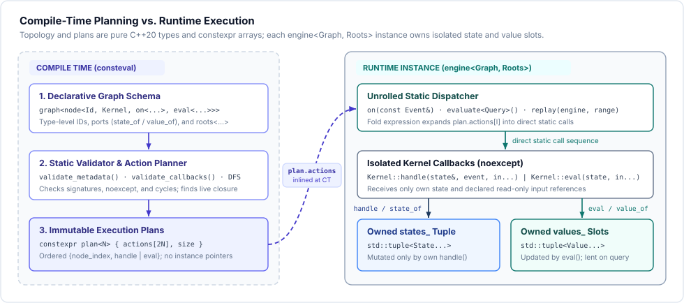
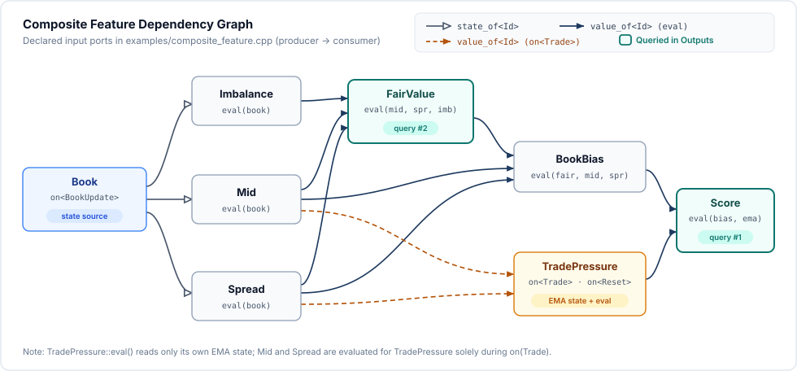
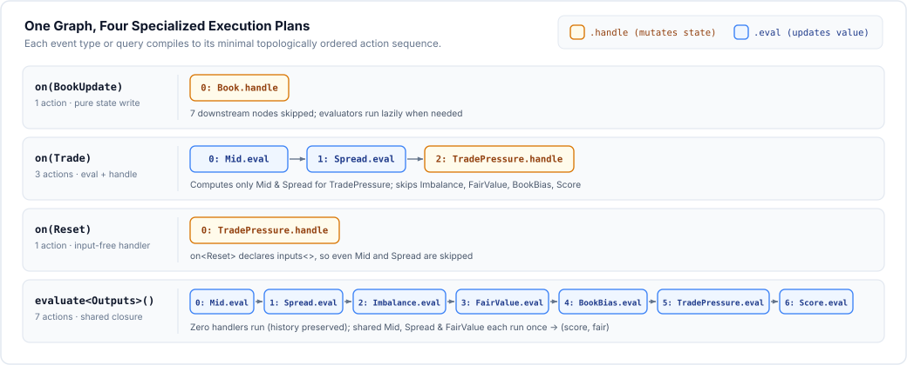

# FlexModelPlanner

**FlexModelPlanner** is a zero-dependency, header-only C++20 library for compiling and executing event-driven feature graphs over streaming data such as order-book updates, trades, and timers. Graph declarations, structural validation, and dependency scheduling happen entirely at compile time (`consteval`); at runtime, an `engine` instance owns isolated node state and dispatches events through unrolled static call sequences without dynamic allocation on the hot path.

Unlike value-cutoff incremental frameworks, streaming feature computation is **path-dependent**: two consecutive trades at the same price are distinct market observations that must both advance a rolling window or exponential moving average, whereas querying outputs must inspect current features without mutating event history. FlexModelPlanner captures this distinction directly by separating **event handlers** (`on<Event>`, executed once per matching event to update private state) from **evaluators** (`eval`, executed on demand to project read-only values). The design is an independent C++20 implementation inspired by Jane Street's [Flex Model](https://blog.janestreet.com/flex-model-an-event-driven-feature-engineering-system/).

---

## Quick Start

Building the examples requires GNU Make and a C++20 compiler (GCC or Clang); running the test suite additionally requires Python 3:

```sh
make -j
make -j test
./build-make/composite_feature
```

To build with Clang or customize flags, use a separate `BUILD_DIR`:

```sh
make -j test CXX=clang++ BUILD_DIR=build-clang
```

On Windows, run the same commands inside WSL2 or an MSYS2 UCRT64 shell with `make`, MinGW-w64 GCC, and Python installed (`make help` lists all targets and configurable variables).

---

## Background: Why Flex Model?

In [*Flex Model: An Event-Driven Feature Engineering System*](https://blog.janestreet.com/flex-model-an-event-driven-feature-engineering-system/), Jane Street describes why general-purpose self-adjusting computation frameworks (such as their own **Incremental** library) are a poor fit for stateful market-data features:

1. **Cutoffs and coalescing corrupt event history**: Spreadsheet-like incremental DAGs optimize for point-in-time functions by coalescing bursts of updates and cutting off propagation when an intermediate value does not change. In market streams, however, every event is a distinct observation—two trades at the same price must both update an EMA or rolling count, and a trade handler reading mid-price must observe the book *at that exact trade*, not a coalesced batch.
2. **Lazy evaluation conflicts with stateful updates**: Embedding mutable ring buffers or accumulators inside lazily evaluated nodes makes state depend on *when* downstream consumers happen to query the graph, breaking parity between live trading and offline research replay.
3. **Static topology unlocks static scheduling**: Feature graphs rarely need to rewire themselves mid-run. By trading away runtime graph dynamism, the system can split every feature node into two explicit roles—**event handlers** that advance local state on every relevant event, and **pure evaluators** that compute values on demand—and compile a dedicated, minimal call schedule for each event type ahead of time.

**FlexModelPlanner** brings this core execution model to C++20 as a lightweight, independent library: graph topology, live-root pruning, and per-event/per-query topological schedules are computed entirely via `consteval` metaprogramming and unrolled into direct, inlinable static calls, while data ingestion, transport, and model inference remain cleanly decoupled in user code.

---

## Design Model & API Overview

Everything is exposed under `namespace flexmodel` via `<flexmodel/flexmodel.hpp>`:

| Construct | Role |
|---|---|
| `node<Id, Kernel, Operations...>` | Binds a unique tag type `Id` to a `Kernel` (`state_type`, optional `value_type`) and its operations |
| `graph<Nodes...>` | Declares a static feature topology across one or more `node` definitions |
| `state_of<Id>` / `value_of<Id>` | Typed read-only input ports reading a producer's `state_type` or evaluated `value_type` |
| `on<Event, Inputs, Fn>` | Subscribes a node to `Event`; mutates the node's own state (`Kernel::handle` by default) |
| `eval<Inputs, Fn>` | Computes `Kernel::value_type` from `const state_type&` and inputs (`Kernel::eval` by default) |
| `engine<Graph, Roots>` | Owns per-instance state and output slots; `roots<Ids...>` prunes unreachable subgraphs at compile time |
| `query<Ids...>` / `evaluate<Query>()` | Evaluates the deduplicated dependency closure and borrows `std::tuple<const Value&...>` |
| `evaluate_into<Query>(tuple&)` | Evaluates `Query` and copies outputs into caller-owned storage |
| `replay(engine, range, observer)` | Dispatches typed or `std::variant` event streams in input order |
| `event_plan<E>()` / `query_plan<Q>()` / `dump_plan` | Exposes and formats compiled `constexpr plan<N>` action sequences for inspection |



At compile time, `engine<Graph, Roots>` validates node IDs, port targets, `noexcept` callback signatures, and per-event/per-query acyclicity. When `roots<Ids...>` is supplied instead of the default `all_nodes`, the planner computes the transitive dependency closure across all handler and evaluator inputs of reachable nodes, excluding dead nodes from generated plans while preserving a uniform `state_tuple` layout.

Generated `plan<N>` objects hold only `{node_index, action_kind}` entries—never instance pointers. Multiple `engine` instances can therefore be constructed, moved, or run on separate threads without replanning or shared mutable state.

---

## Walkthrough: Composite Market Feature

The [composite_feature.cpp](examples/composite_feature.cpp) example combines instantaneous order-book liquidity with an exponential moving average (EMA) of trade-price dislocations across an eight-node DAG:



| Node | Role and formula |
|---|---|
| `Book` | Stores latest quote (`bid`, `ask`, `bid_size`, `ask_size`) on `BookUpdate` |
| `Mid` | `(bid + ask) / 2` from `state_of<BookId>` |
| `Spread` | `ask - bid` from `state_of<BookId>` |
| `Imbalance` | `(bid_size - ask_size) / (bid_size + ask_size)` (`0` when total size is `0`) |
| `FairValue` | Size-weighted microprice: `mid + 0.5 * spread * imbalance` |
| `BookBias` | Normalized book signal: `(fair - mid) / spread` (`0` when `spread <= 0`) |
| `TradePressure` | Stateful EMA (`α = 0.5`) of `(trade.price - mid) / spread`, updated on `Trade` and cleared on `Reset` |
| `Score` | Composite signal: `book_bias + trade_pressure` |

### Complete Program

```cpp
#include <flexmodel/flexmodel.hpp>
#include <iomanip>
#include <iostream>
#include <tuple>

namespace fm = flexmodel;

struct BookUpdate { double bid{}, ask{}, bid_size{}, ask_size{}; };
struct Trade { double price; };
struct Reset {};

struct BookId {};
struct MidId {};
struct SpreadId {};
struct ImbalanceId {};
struct FairValueId {};
struct BookBiasId {};
struct TradePressureId {};
struct ScoreId {};

struct Book {
    using state_type = BookUpdate;
    static void handle(state_type& state, const BookUpdate& event) noexcept {
        state = event;
    }
};

// Stateless scalar evaluators share these two type declarations.
struct Scalar {
    struct state_type {};
    using value_type = double;
};

struct Mid : Scalar {
    static double eval(const state_type&, const BookUpdate& book) noexcept {
        return book.bid / 2.0 + book.ask / 2.0;
    }
};

struct Spread : Scalar {
    static double eval(const state_type&, const BookUpdate& book) noexcept {
        return book.ask - book.bid;
    }
};

struct Imbalance : Scalar {
    static double eval(const state_type&, const BookUpdate& book) noexcept {
        const double size = book.bid_size + book.ask_size;
        return size > 0.0 ? (book.bid_size - book.ask_size) / size : 0.0;
    }
};

struct FairValue : Scalar {
    static double eval(const state_type&, const double& mid,
                       const double& spread, const double& imbalance) noexcept {
        return mid + 0.5 * spread * imbalance;
    }
};

struct BookBias : Scalar {
    static double eval(const state_type&, const double& fair,
                       const double& mid, const double& spread) noexcept {
        return spread > 0.0 ? (fair - mid) / spread : 0.0;
    }
};

struct TradePressure {
    struct state_type { double ema = 0.0; bool initialized = false; };
    using value_type = double;

    static void handle(state_type& state, const Trade& event,
                       const double& mid, const double& spread) noexcept {
        const double sample = spread > 0.0 ? (event.price - mid) / spread : 0.0;
        state.ema = state.initialized ? 0.5 * state.ema + 0.5 * sample : sample;
        state.initialized = true;
    }
    static void handle(state_type& state, const Reset&) noexcept { state = {}; }
    static double eval(const state_type& state) noexcept { return state.ema; }
};

struct Score : Scalar {
    static double eval(const state_type&, const double& bias,
                       const double& pressure) noexcept {
        return bias + pressure;
    }
};

using Graph = fm::graph<
    fm::node<BookId, Book, fm::on<BookUpdate>>,
    fm::node<MidId, Mid, fm::eval<fm::inputs<fm::state_of<BookId>>>>,
    fm::node<SpreadId, Spread, fm::eval<fm::inputs<fm::state_of<BookId>>>>,
    fm::node<ImbalanceId, Imbalance, fm::eval<fm::inputs<fm::state_of<BookId>>>>,
    fm::node<FairValueId, FairValue,
        fm::eval<fm::inputs<fm::value_of<MidId>, fm::value_of<SpreadId>,
                            fm::value_of<ImbalanceId>>>>,
    fm::node<BookBiasId, BookBias,
        fm::eval<fm::inputs<fm::value_of<FairValueId>, fm::value_of<MidId>,
                            fm::value_of<SpreadId>>>>,
    fm::node<TradePressureId, TradePressure,
        fm::on<Trade, fm::inputs<fm::value_of<MidId>, fm::value_of<SpreadId>>>,
        fm::on<Reset>, fm::eval<>>,
    fm::node<ScoreId, Score,
        fm::eval<fm::inputs<fm::value_of<BookBiasId>, fm::value_of<TradePressureId>>>>
>;
using Outputs = fm::query<ScoreId, FairValueId>;

int main() {
    fm::engine<Graph, fm::roots<ScoreId>> model;
    model.on(BookUpdate{99.0, 101.0, 30.0, 10.0});
    model.on(Trade{101.0});
    model.on(BookUpdate{100.0, 104.0, 10.0, 30.0});
    model.on(Trade{103.0});
    model.on(Trade{103.0});  // The same price still changes the EMA.

    std::cout << std::fixed << std::setprecision(4);
    const auto print = [&](const char* label) {
        const auto [score, fair] = model.evaluate<Outputs>();
        std::cout << label << ": score=" << score << ", fair=" << fair << '\n';
    };
    print("before reset");
    model.on(Reset{});
    print("after reset");
}
```

Running `./build-make/composite_feature` prints:

```text
before reset: score=0.0625, fair=101.0000
after reset: score=-0.2500, fair=101.0000
```

Across the three trades, `(price - mid) / spread` evaluates to `0.5`, `0.25`, and `0.25`, stepping the EMA through `0.5 → 0.375 → 0.3125`—the second `Trade{103.0}` updates state even though its price is unchanged. On the second book (`mid = 102`, `spread = 4`, `imbalance = -0.5`), `fair` is `101.0` and `book_bias` is `-0.25`, yielding `score = -0.25 + 0.3125 = 0.0625`. Dispatching `Reset{}` zeroes the EMA while leaving `Book` intact, so `score` becomes `-0.2500`.

### Specialized Per-Event and Query Plans

From that single `Graph` definition, the planner synthesizes four distinct static call sequences:



Key properties of the compiled plans:

- **Minimal event work**: `on(Trade)` evaluates `Mid` and `Spread` because `TradePressure`'s `Trade` handler declares them as `value_of` ports, while leaving `Imbalance`, `FairValue`, `BookBias`, and `Score` untouched. `on(Reset)` declares no inputs and invokes `TradePressure.handle` directly.
- **Shared-subgraph deduplication**: `evaluate<Outputs>()` computes `Mid`, `Spread`, and `FairValue` once even though `FairValue` is both a requested query output and an input to `BookBias`. Execution follows dependency order (`FairValue` before `Score`), whereas the returned tuple matches `query<ScoreId, FairValueId>` (`score`, then `fair`).
- **Explicit port binding & kernel reuse**: Callback argument order mirrors `inputs<...>` port order; kernels never receive an opaque engine-wide context. Explicit function pointers or stateless callables can override defaults via `on<Event, Inputs, &fn>` and `eval<Inputs, &fn>`.
- **Runtime configuration**: While topology is fixed at compile time, node state is ordinary runtime data. In [market_kernels.hpp](examples/market_kernels.hpp), a single `RecentDiffKernel` backs both 10-trade and 3-trade rolling windows under separate node IDs, parameterized at startup via `engine(state_tuple)`.

---

## Execution Semantics & Guarantees

- **Zero-copy queries vs. owned snapshots**: `evaluate<Query>()` returns `std::tuple<const Value&...>` borrowing directly from the engine's internal value slots. References remain valid until the engine is moved or destroyed, and slot contents may be updated by subsequent evaluations. Call `evaluate_into<Query>(dest_tuple)` when retaining an independent copy. `state<Id>()` exposes read-only node state; `cached_value<Id>()` reads an output slot without triggering evaluation.
- **Hot-path allocation**: Plan construction allocates nothing at runtime. Kernels may allocate during startup in `state_type` constructors (such as sizing ring buffers once), after which framework dispatch in `on()` and `evaluate()` performs zero dynamic allocations.
- **Exceptions and concurrency**: All handler and evaluator callbacks are statically verified as `noexcept`, and evaluator `value_type` slots require `noexcept` assignment. Each `engine` instance is single-threaded and non-reentrant; separate instances share no mutable state and can run concurrently across threads without synchronization.
- **Diagnostics and differential execution**: `engine::event_plan<Event>()` and `engine::query_plan<Query>()` return `constexpr plan<N>` values printable with `dump_plan`. `on_interpreted` and `evaluate_interpreted` execute the same `plan<N>` through a function-pointer table for differential testing against the unrolled dispatcher.

---

## Stream Replay

`flexmodel::replay(engine, records, observer)` (and `replay_interpreted`) processes any `std::ranges::input_range` of concrete event structs or `std::variant<Events...>` values in input order, invoking the optional `observer(engine, event, index)` after each event. Applications control timestamp ordering, I/O framing, and persistence outside the engine.

The repository includes a standalone CLI replay example ([examples/csv_replay.cpp](examples/csv_replay.cpp)) supporting `B,bid,ask` (book), `T,price` (trade), `R` (reset), and `Q` (query) records from a file or standard input:

```sh
printf 'B,100,102\nT,103\nT,103\nQ\n' | ./build-make/csv_replay -
```

---

## Integration & Installation

FlexModelPlanner is header-only with no external C++ dependencies. Point your C++20 compiler at `include/`:

```sh
g++ -std=c++20 -O2 -I/path/to/FlexModelPlanner/include my_program.cpp -o my_program
```

To install headers under a prefix (with optional `DESTDIR` staging for packaging):

```sh
make install PREFIX="$HOME/.local"
g++ -std=c++20 -O2 -I"$HOME/.local/include" my_program.cpp -o my_program
```

---

## Verification & Benchmarks

Detailed contracts and verification artifacts live in:

- [SPECS.md](SPECS.md) — Normative API synopsis, type requirements, scheduling rules, and lifetime contracts.
- [docs/architecture.md](docs/architecture.md) — Planner internals, compile-time complexity, and memory layout.
- [docs/verification.md](docs/verification.md) — Test matrix and bounded TLA+/TLC model-checking report.
- [AGENTS.md](AGENTS.md) — Contributor invariants and verification gates.

The test and verification suite checks multiple independent layers:

1. **Functional, replay, and allocation tests (`make test`)**: Verifies event history, shared-dependency deduplication, root pruning, instance isolation, static vs. interpreted equivalence, independent arithmetic reference oracles, zero C++ `new` calls on the hot path (`tests/test_noalloc.cpp`), and a staged `make install` consumer build.
2. **Exhaustive small-graph planner verification**: `tests/test_planner_properties.cpp` enumerates all `65,536` (`2^16`) directed graphs over 4 actions across all `16` root subsets (`1,048,576` cases), checking cycle rejection, reachability, and topological order against independent reference algorithms.
3. **Diagnostic-checked negative compilation tests**: 19 invalid programs in `tests/compile_fail/` are compiled under `-fsyntax-only`, asserting the exact expected diagnostic message for each structural, signature, `noexcept`, or cycle violation.
4. **Sanitizers & formal model checking**:

```sh
make -j sanitize SANITIZE_CXX=clang++
make model-check
```

`make model-check` runs five bounded TLA+/TLC specifications (requiring Java 17+, Bash, and `curl`; downloads and SHA-256-verifies `tla2tools.jar` on first run unless `TLA_TOOLS_JAR` is set).

An optional microbenchmark compares unrolled static dispatch against `plan<N>` interpretation (verifying matching output checksums after warm-up):

```sh
make benchmark
```

---

## License

Released under the [MIT License](LICENSE).
