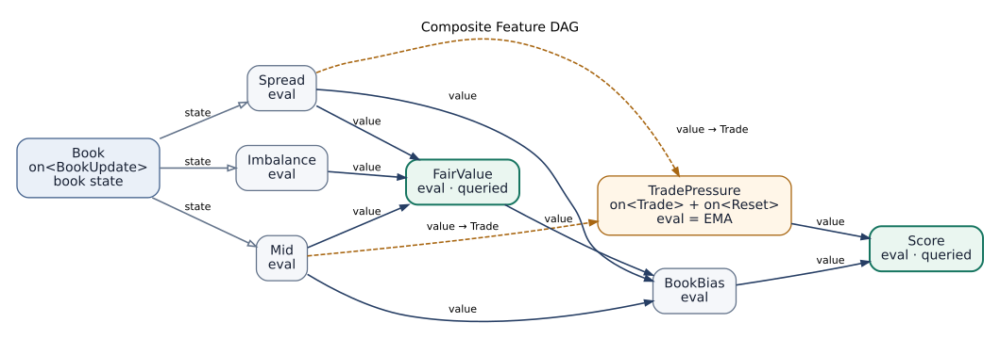

# FlexModelPlanner

FlexModelPlanner is a C++20 library for computing features from streams of events such as order-book updates, trades, and timers. It compiles node dependencies into a separate execution plan for each event type. Two trades at the same price still run the handler twice; queries compute values without advancing event history.

This is an independent implementation inspired by Jane Street's [Flex Model blog post](https://blog.janestreet.com/flex-model-an-event-driven-feature-engineering-system/). It provides static graph planning, state ownership, execution, and replay primitives. Applications supply market-data ingestion, timestamp ordering, and persistence.

## Quick start

You need GNU Make and a C++20 compiler; running the tests also requires Python 3. The library is header-only and has no third-party C++ dependencies. From the repository root, run:

```sh
make -j
make test
./build-make/recent_trade_vs_mid
./build-make/csv_replay examples/sample.csv
```

The first example prints the book, trade, reset, and query plans, followed by:

```text
recent10=1.66667, recent3=1.66667
```

The three recorded `trade_price - mid` differences are `2, 2, 1`. Both features use the same kernel, with independent windows of 10 and 3 trades. During warm-up, each average uses the number of trades received so far. The CSV example produces:

```text
Q,1.66667,1.66667
Q,0,0
Q,2,2
```

On Windows, use WSL2 or an MSYS2 UCRT64 shell with GNU Make, GCC, and Python installed. The same commands work there; native Windows executables have an `.exe` suffix. Use `make help` to list targets, and `CXX=clang++ BUILD_DIR=build-clang` to select Clang. Use separate build directories when changing compilers or build flags.

## Defining a feature

This example combines current book liquidity with the history of trade prices. Its eight-node DAG contains shared inputs, several layers of evaluation, and a stateful node that updates on trades. An `Id` identifies a node, a `Kernel` implements its state and computation, and a `node` declares its handlers, evaluator, and input ports.



Arrows point from an input to its consumer. Mid, Spread, and Imbalance read **Book state**. All other edges read computed **values**. The two edges into TradePressure belong to its **Trade handler**; its evaluator only reads the EMA stored in its own state. Event delivery and Reset are omitted from this dependency view.

| Node | Computation or stored state |
|---|---|
| Book | Latest bid, ask, and sizes, updated by `BookUpdate` |
| Mid | `(bid + ask) / 2` |
| Spread | `ask - bid` |
| Imbalance | `(bid_size - ask_size) / (bid_size + ask_size)` |
| FairValue | `mid + 0.5 * spread * imbalance`, the size-weighted microprice |
| BookBias | `(fair - mid) / spread`, a dimensionless current-book signal |
| TradePressure | An EMA of `(trade_price - mid) / spread`, sampled at each trade |
| Score | `book_bias + trade_pressure` |

The first trade initializes the EMA; later trades give equal weight to the previous EMA and the new sample. Zero total size produces zero imbalance, and a nonpositive spread produces zero normalized bias/sample. The supplied events use finite, valid quotes and nonnegative sizes; input validation belongs at the application boundary.

The complete program is also available as [composite_feature.cpp](examples/composite_feature.cpp):

```cpp
#include <flexmodel/flexmodel.hpp>
#include <iomanip>
#include <iostream>
#include <tuple>

namespace fm = flexmodel;

struct BookUpdate { double bid{}, ask{}, bid_size{}, ask_size{}; };
struct Trade { double price; };
struct Reset {};

struct BookId {};
struct MidId {};
struct SpreadId {};
struct ImbalanceId {};
struct FairValueId {};
struct BookBiasId {};
struct TradePressureId {};
struct ScoreId {};

struct Book {
    using state_type = BookUpdate;
    static void handle(state_type& state, const BookUpdate& event) noexcept {
        state = event;
    }
};

// Stateless scalar evaluators share these two type declarations.
struct Scalar {
    struct state_type {};
    using value_type = double;
};

struct Mid : Scalar {
    static double eval(const state_type&, const BookUpdate& book) noexcept {
        return book.bid / 2.0 + book.ask / 2.0;
    }
};

struct Spread : Scalar {
    static double eval(const state_type&, const BookUpdate& book) noexcept {
        return book.ask - book.bid;
    }
};

struct Imbalance : Scalar {
    static double eval(const state_type&, const BookUpdate& book) noexcept {
        const double size = book.bid_size + book.ask_size;
        return size > 0.0 ? (book.bid_size - book.ask_size) / size : 0.0;
    }
};

struct FairValue : Scalar {
    static double eval(const state_type&, const double& mid,
                       const double& spread, const double& imbalance) noexcept {
        return mid + 0.5 * spread * imbalance;
    }
};

struct BookBias : Scalar {
    static double eval(const state_type&, const double& fair,
                       const double& mid, const double& spread) noexcept {
        return spread > 0.0 ? (fair - mid) / spread : 0.0;
    }
};

struct TradePressure {
    struct state_type { double ema = 0.0; bool initialized = false; };
    using value_type = double;

    static void handle(state_type& state, const Trade& event,
                       const double& mid, const double& spread) noexcept {
        const double sample = spread > 0.0 ? (event.price - mid) / spread : 0.0;
        state.ema = state.initialized ? 0.5 * state.ema + 0.5 * sample : sample;
        state.initialized = true;
    }
    static void handle(state_type& state, const Reset&) noexcept { state = {}; }
    static double eval(const state_type& state) noexcept { return state.ema; }
};

struct Score : Scalar {
    static double eval(const state_type&, const double& bias,
                       const double& pressure) noexcept {
        return bias + pressure;
    }
};

using Graph = fm::graph<
    fm::node<BookId, Book, fm::on<BookUpdate>>,
    fm::node<MidId, Mid, fm::eval<fm::inputs<fm::state_of<BookId>>>>,
    fm::node<SpreadId, Spread, fm::eval<fm::inputs<fm::state_of<BookId>>>>,
    fm::node<ImbalanceId, Imbalance, fm::eval<fm::inputs<fm::state_of<BookId>>>>,
    fm::node<FairValueId, FairValue,
        fm::eval<fm::inputs<fm::value_of<MidId>, fm::value_of<SpreadId>,
                            fm::value_of<ImbalanceId>>>>,
    fm::node<BookBiasId, BookBias,
        fm::eval<fm::inputs<fm::value_of<FairValueId>, fm::value_of<MidId>,
                            fm::value_of<SpreadId>>>>,
    fm::node<TradePressureId, TradePressure,
        fm::on<Trade, fm::inputs<fm::value_of<MidId>, fm::value_of<SpreadId>>>,
        fm::on<Reset>, fm::eval<>>,
    fm::node<ScoreId, Score,
        fm::eval<fm::inputs<fm::value_of<BookBiasId>, fm::value_of<TradePressureId>>>>
>;
using Outputs = fm::query<ScoreId, FairValueId>;

int main() {
    fm::engine<Graph, fm::roots<ScoreId>> model;
    model.on(BookUpdate{99.0, 101.0, 30.0, 10.0});
    model.on(Trade{101.0});
    model.on(BookUpdate{100.0, 104.0, 10.0, 30.0});
    model.on(Trade{103.0});
    model.on(Trade{103.0});  // The same price still changes the EMA.

    std::cout << std::fixed << std::setprecision(4);
    const auto print = [&](const char* label) {
        const auto [score, fair] = model.evaluate<Outputs>();
        std::cout << label << ": score=" << score << ", fair=" << fair << '\n';
    };
    print("before reset");
    model.on(Reset{});
    print("after reset");
}
```

After `make`, run `./build-make/composite_feature` to get:

```text
before reset: score=0.0625, fair=101.0000
after reset: score=-0.2500, fair=101.0000
```

The trade samples are `0.5, 0.25, 0.25`, so the EMA evolves through `0.5, 0.375, 0.3125`. The two trades at 103 are separate updates even though their prices match. At the final book, fair value is 101 and book bias is -0.25; adding the EMA gives 0.0625. Reset clears the EMA while preserving the book, leaving a score of -0.25.

The same graph yields different plans:

| Request | Actions in execution order |
|---|---|
| `BookUpdate` | `Book.handle` |
| `Trade` | `Mid.eval → Spread.eval → TradePressure.handle` |
| `Reset` | `TradePressure.handle` for Reset only |
| `evaluate<Outputs>()` | `Mid.eval → Spread.eval → Imbalance.eval → FairValue.eval → BookBias.eval → TradePressure.eval → Score.eval` |

Querying Score and FairValue together computes each shared action once. For example, FairValue is both an output and an input to BookBias. The plan executes FairValue before Score, while the returned tuple follows `query<ScoreId, FairValueId>` and therefore contains `(score, fair)`.

`roots<ScoreId>` keeps all eight nodes live because they lie in Score's dependency closure. TradePressure receives every trade even when no query follows, and evaluating its stored EMA does not advance history. Reset has no input ports, so it does not compute Mid or Spread.

Input port order determines callback argument order: `on<Trade, inputs<value_of<MidId>, value_of<SpreadId>>>` calls `handle(State&, const Trade&, const double& mid, const double& spread)`. Callbacks receive their own state and their declared inputs, rather than an engine-wide context. Use `on<Event, Inputs, &function>` or `eval<Inputs, &function>` when a kernel needs an explicitly selected callback.

The graph is fixed at compile time; configuration can still be ordinary instance data. For example, [market_kernels.hpp](examples/market_kernels.hpp) receives its rolling-window sizes through `make_engine(10, 3)`.

## Plans, state, and queries


By default, `engine<Graph>` schedules all nodes. `engine<Graph, roots<FeatureId>>` schedules only the selected roots and the transitive closure of their operation dependencies. Handlers in that live closure run on every matching event, even when no query follows. Root selection reduces scheduled work; the state tuple still contains every node in the graph. Query outputs must belong to the live closure and have an evaluator.

The planner treats a node's handler and evaluator as separate actions. Before a state read, it runs the producer's handler for the current event, if one exists. A value read also requires the producer's evaluator. Each shared action runs once per plan. Consecutive queries each perform their own evaluation; there is no memoization across queries or cutoff across events.

`evaluate<query<A, B>>()` computes both outputs together and evaluates shared dependencies once. Its `tuple<const Value&...>` borrows references to the engine's output slots, which later evaluations may update. To retain a snapshot, use `evaluate_into<Query>(output_tuple)` to copy values into caller-owned storage. `state<Id>()` exposes a read-only state view; `cached_value<Id>()` explicitly permits a stale value.


`event_plan<Event>()` and `query_plan<Query>()` expose inspectable plans; `dump_plan` prints them for diagnostics. The default executor expands actions into direct template calls. `on_interpreted` and `evaluate_interpreted` dispatch the same plan one action at a time for comparison. Because both executors share the planner, the tests also use independent arithmetic oracles.

Kernel state may allocate at startup. The example's ring buffers do not grow after initialization, and its callbacks and scalar outputs do not allocate. A dedicated test tracks the C++ `new` family: its zero-allocation result covers framework dispatch and the tested example paths. Arbitrary `malloc` calls, custom allocators, and allocations in user kernels remain the application's responsibility to check.

An output `value_type` must be default-constructible and support non-throwing assignment from the returned value. Neither `noexcept` nor read-only parameters guarantee freedom from global side effects. Each engine is single-threaded and non-reentrant; separate instances may be owned by separate threads.

## Replay and integration

`replay(engine, range)` processes a range of typed or `std::variant` events in input order. An optional observer receives `(engine, event, index)` after each event. `replay_interpreted` uses the interpreter.

The CSV program accepts `B,bid,ask`, `T,price`, `R`, and `Q`. `R` clears both history windows; `Q` queries both outputs at that point in the stream. Blank lines and lines beginning with `#` are skipped. The parser checks field counts, finite numbers, bid/ask ordering, and the presence of a book record before the first trade. Errors include a line number and produce a nonzero exit status. Standard input is supported:

```sh
printf 'B,100,102\nT,103\nT,103\nQ\n' | ./build-make/csv_replay -
```

To use the library, add its `include/` directory to your compiler's header search path:

```sh
g++ -std=c++20 -I/path/to/FlexModelPlanner/include my_program.cpp -o my_program
```

There is no library binary to link. To install the headers under a chosen prefix:

```sh
make install PREFIX="$HOME/.local"
g++ -std=c++20 -I"$HOME/.local/include" my_program.cpp -o my_program
```

`DESTDIR` is supported for staged installation. `make clean` removes the selected `BUILD_DIR`; by default this is `build-make`.

## Validation and development

See [SPECS.md](SPECS.md) for the behavior contract, [AGENTS.md](AGENTS.md) for development conventions, and the [architecture notes](docs/architecture.md) for implementation structure and constraints. Tests cover event history, action ordering, query deduplication, root selection, instance isolation, independent arithmetic oracles, static/interpreted equivalence, replay, and allocation behavior. Negative tests invoke the selected compiler on each invalid program and require the intended diagnostic, not just a nonzero exit status.

The action-ordering test also enumerates all 65,536 directed graphs over four actions and all 16 root subsets: 1,048,576 cases in total. Independent reachability analysis and Kahn's algorithm check the production planner's cycle detection, action set, and dependency ordering.

The [verification report](docs/verification.md) records the formal models, their mapping to the code, bounded-check results, and the C++, floating-point, and runtime concerns outside those models. The project uses the [MIT license](LICENSE).

```sh
make model-check
```

Model checking requires Java 17+, Bash, and curl. On its first run, the script downloads a pinned TLA+ tools version and verifies its SHA-256 hash. Results are written to `build-tla/`. Set `TLA_TOOLS_JAR` to use a local copy of the same version. CI runs this check as well.

```sh
make -j test CXX=clang++ BUILD_DIR=build-clang
make -j sanitize
```

The optional microbenchmark processes a trade and immediately queries both outputs on the same graph. After 10,000 warm-up iterations, it reports elapsed time divided by the iteration count. It prints results only if both execution paths produce the same checksum. This measures average iteration time, not tail latency or performance across machines:

```sh
make benchmark
```
